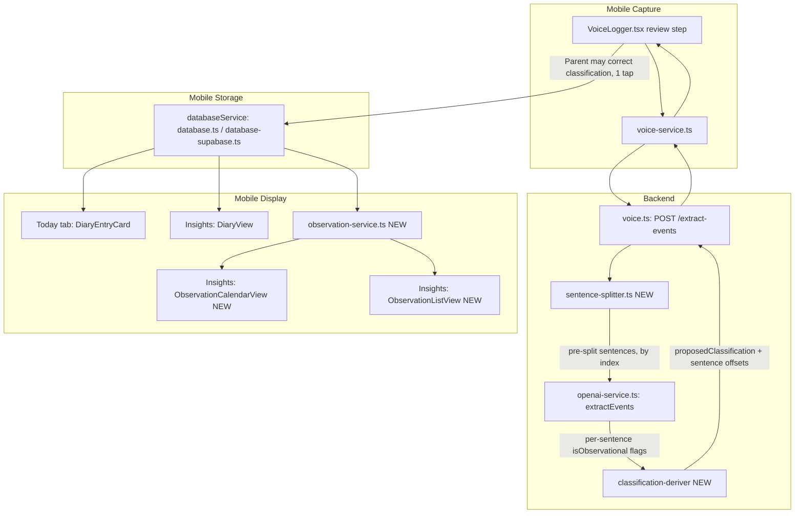

# Design Document: Parent Observations

## Overview

This feature extends the existing `DiaryEntry` model (`mobile/models/diary-entry.ts`, `diary_entries` table) with an Entry_Classification (`isDiary`/`isObservation` flags) and optional sentence-level highlighting, rather than introducing a new model or table. No Entry is ever split — one voice/text submission still produces at most one `DiaryEntry` row, exactly as today.

The key design decision is **how the AI identifies observational content without being able to corrupt it**. Rather than asking the LLM to mark up the actual text (which risks the same kind of subtle alteration a "diff and strip markers" check can only catch after the fact), the backend deterministically splits the relevant text into sentences first — using plain code, not the model — and asks the LLM only to classify sentences **by index** ("sentences 2 and 4 are observational") against that fixed, pre-chunked list. The LLM is never asked to reproduce or re-emit the text itself, so there is no path by which its response could alter a word of what the Parent said. The Entry_Classification itself (Diary / Observation / Both) is then **derived in code** from that per-sentence signal, not asked of the LLM as a separate holistic judgment — this keeps the AI's actual job narrow and mechanically checkable, the same lesson applied to the `title` field fix earlier this project (`backend/src/services/openai-service.ts`'s `extractEvents`).

This is a strictly stronger guarantee than the "strip markers and diff against the original" mechanism described at the requirements stage: here, content corruption is structurally impossible rather than merely detected-and-discarded, because the original text never round-trips through the model a second time. The verification step (Requirement 3.2/3.3) still exists, but becomes "are the returned sentence indices valid integers within range," which is cheap, deterministic, and sufficient.

## Architecture



**Data flow for one submission:**
1. Parent records/types as today; `voiceService.extractEvents()`/`processRecording()` calls the backend exactly as before.
2. Backend deterministically splits the raw transcript into sentences (character offsets), and — if a diary summary is generated — separately splits that summary text into sentences too. Both splits happen in plain code, before any LLM call that touches sentence content.
3. One extraction LLM call (same call already used for events/description/title/emoji) additionally receives the enumerated sentence list(s) and returns which sentence *indices*, per text, read as observational — a narrow, index-only judgment.
4. Backend derives `proposedClassification` (`isDiary`/`isObservation`) in code from the per-sentence flags, and maps flagged indices back to character offsets (already known from step 2 — no further LLM involvement).
5. Mobile receives `proposedClassification` plus two offset arrays (one for transcript sentences, one for summary sentences). The review step shows the proposed classification as a pre-set, one-tap-correctable control, exactly as described in requirements.
6. At save time, `VoiceLogger.tsx` picks the offset array matching whichever content mode (verbatim transcript vs. AI summary) the Parent is saving, stores those offsets alongside the final `isDiary`/`isObservation` flags (AI-proposed or Parent-corrected) on the `DiaryEntry` row.
7. Display sites (Today tab, Diary view, new Observation Calendar/List) read `isDiary`/`isObservation`/stored offsets to color cards and build excerpts — no further AI involvement at display time.

## Components and Interfaces

### 1. Backend: deterministic sentence splitter (new)

**`backend/src/utils/sentence-splitter.ts`** (new file; no sentence-tokenizing utility exists anywhere in this codebase today, confirmed by search):

```ts
export interface Sentence {
  index: number;
  text: string;
  start: number; // character offset into the original string
  end: number;   // exclusive
}

/**
 * Deterministic, regex-based sentence split - no NLP library, no LLM
 * involvement. Good enough for "sentence 2 vs sentence 4", not aiming for
 * perfect handling of every abbreviation/edge case; a slightly wrong split
 * only affects highlighting granularity, never content integrity, since
 * offsets are always validated as in-range substrings of the original
 * text regardless of how "correct" the split boundaries are.
 */
export function splitIntoSentences(text: string): Sentence[];
```

This lives only in the backend (the only runtime that calls the LLM and needs to pre-chunk text for it) — mobile never implements or needs its own copy, since mobile only ever receives and stores already-computed offsets, never recomputes them.

### 2. Backend: extraction prompt and response shape changes

**`backend/src/services/openai-service.ts`** — extends the existing single `extractEvents()` call (same call that already produces `events`, `title`, `description`, `emoji` — no new LLM round trip):

- Before building the prompt, call `splitIntoSentences(transcript)`. If a diary summary is being generated in this same call, the model's own `diaryEntry` output is split the same way *after* the response comes back (the summary text doesn't exist until the model generates it, so its sentences can only be enumerated post-hoc — see step below).
- Prompt addition: present the numbered transcript sentence list, and ask the model to return `transcriptObservationalIndices: number[]` — e.g. "Sentence 3 ('I've noticed he's gotten so much more verbal lately') is a general observation, not a dated event — return its index." Reuses the same cue-phrase guidance ("I've noticed", "in general", "lately", "over the past week") discussed and agreed on earlier in this project, now scoped to a well-defined index-selection task instead of free-form classification.
- After the response returns (so `diaryEntry` text actually exists), run `splitIntoSentences(diaryEntry)` and make a second, smaller follow-up classification pass **only if** `diaryEntry` is present and non-empty — reusing the same "given these N sentences, which indices are observational" prompt shape against the summary text. This is a second small LLM call, not a second full extraction; kept separate because the summary doesn't exist until after the first call completes.
- Both passes return indices only — never asked to repeat or alter any text.

New/changed types:

```ts
export interface SentenceSpan {
  start: number;
  end: number;
  isObservational: boolean;
}

interface EventExtractionResult {
  events: ExtractedEvent[];
  diaryEntry?: string;
  // Offsets into the RAW TRANSCRIPT - used when the Parent saves in
  // Verbatim mode.
  transcriptSentences?: SentenceSpan[];
  // Offsets into `diaryEntry` - used when the Parent saves in AI Summary
  // mode. Absent if diaryEntry is absent/empty.
  summarySentences?: SentenceSpan[];
  // Derived in code (see classification-deriver below), not asked of the
  // LLM as a holistic judgment.
  proposedClassification: { isDiary: boolean; isObservation: boolean };
}
```

**Verification (Requirement 3.2/3.3), concretely:** after the LLM returns `transcriptObservationalIndices`/`summaryObservationalIndices`, the backend checks every index is an integer within `[0, sentences.length)`. Indices failing this check are dropped individually (one bad index doesn't invalidate the whole response) unless the entire response is unusable (e.g. not an array, or every index is invalid), in which case that text's `SentenceSpan[]` is omitted entirely and `proposedClassification` falls back per Requirement 1.9. Because the model only ever returns small integers, not text, this check is simple bounds validation — there's no "diff the stripped text" step needed, since there's no embedded text to strip in the first place.

### 3. Backend: classification deriver (new, small, pure function)

```ts
// backend/src/services/classification-deriver.ts
export function deriveClassification(
  transcriptSentences: SentenceSpan[] | undefined,
  summarySentences: SentenceSpan[] | undefined,
): { isDiary: boolean; isObservation: boolean } {
  // Uses whichever span list is available (prefers transcript - it always
  // exists; summary spans may be absent if no diaryEntry was generated).
  // hasObservational / hasNonObservational computed from that one list:
  //   - no observational sentences found -> { isDiary: true, isObservation: false }
  //   - every sentence observational     -> { isDiary: false, isObservation: true }
  //   - a mix of both                    -> { isDiary: true, isObservation: true }
  //   - no sentences at all (empty text) -> { isDiary: true, isObservation: false }
}
```

Kept as a small, independently testable pure function rather than inline in `extractEvents()`, both because it's a pure derivation with no I/O (easy to unit test later if a test runner is ever added, consistent with how `location-service.ts`'s resolution logic was centralized in the prior spec) and because it's the one piece of this feature with actual branching logic worth isolating from the LLM-calling code around it.

### 4. Mobile: `voice-service.ts` and `VoiceLogger.tsx` changes

**`mobile/services/voice-service.ts`** — `EventExtractionResult` interface widened to mirror the backend's new fields (`transcriptSentences`, `summarySentences`, `proposedClassification`), passed through unchanged exactly as `diaryEntry`/`events` are today.

**`mobile/components/VoiceLogger.tsx`** — new state alongside the existing `includeDiary`/`useSummarizedDiary`/`diaryEntry` state (same block, lines ~33-36):

```ts
const [isDiary, setIsDiary] = useState(true);
const [isObservation, setIsObservation] = useState(false);
const [transcriptSentences, setTranscriptSentences] = useState<SentenceSpan[]>([]);
const [summarySentences, setSummarySentences] = useState<SentenceSpan[]>([]);
```

On extraction (`handleReExtract` and the initial processing flow, same call sites that currently do `setDiaryEntry(result.diaryEntry || '')`), also do:
```ts
setIsDiary(result.proposedClassification?.isDiary ?? true);
setIsObservation(result.proposedClassification?.isObservation ?? false);
setTranscriptSentences(result.transcriptSentences ?? []);
setSummarySentences(result.summarySentences ?? []);
```

**Review-step UI** — a new three-segment control added inside the existing `{includeDiary && (...)}` block (`mobile/components/VoiceLogger.tsx` lines ~872-927), placed after the existing Verbatim/AI Summary `radioOption` row, reusing the identical `radioOption`/`radioCircle`/`radioLabel` visual pattern already established there for a three-way choice:

```tsx
{includeDiary && (
  <View style={styles.diaryFormatOptions}>
    {/* existing AI Summary / Verbatim radio row, unchanged */}
  </View>
)}

{includeDiary && (
  <View style={styles.classificationOptions}>
    {(['diary', 'observation', 'both'] as const).map((option) => (
      <TouchableOpacity
        key={option}
        onPress={() => {
          setIsDiary(option === 'diary' || option === 'both');
          setIsObservation(option === 'observation' || option === 'both');
        }}
        style={styles.radioOption}
      >
        <View style={[styles.radioCircle, isSelected(option) && styles.radioCircleSelected]}>
          {isSelected(option) && <View style={styles.radioDot} />}
        </View>
        <Text style={styles.radioLabel}>
          {option === 'diary' ? '📔 Diary' : option === 'observation' ? '🌱 Observation' : '📔🌱 Both'}
        </Text>
      </TouchableOpacity>
    ))}
  </View>
)}
```

This control is nested inside `includeDiary` (not a sibling), because Entry_Classification only has meaning for an Entry that is actually being created — matching how `includeDiary` already gates whether any `DiaryEntry` row gets created at all. The control arrives **pre-selected** per the AI's `proposedClassification` (no parent interaction required, satisfying Requirement 1.5) and is changed with a single tap, exactly like the existing Verbatim/AI Summary toggle.

**Save-time logic** (`handleSave()`, same block that currently computes `diaryContent`):

```ts
const diaryContent = useSummarizedDiary ? diaryEntry : transcript;
const relevantSpans = useSummarizedDiary ? summarySentences : transcriptSentences;
const highlightedRanges = relevantSpans.filter(s => s.isObservational).map(({ start, end }) => ({ start, end }));

await databaseService.createDiaryEntry({
  ...,
  content: diaryContent,
  isDiary,
  isObservation,
  highlightedRanges: highlightedRanges.length > 0 ? highlightedRanges : undefined,
  localDate: toLocalDateString(logDate),
});
```

Picking the span array matching the content mode is what makes this safe: `transcriptSentences` offsets are only ever valid against `transcript`, and `summarySentences` offsets only ever valid against `diaryEntry` — since `diaryContent` is exactly one of those two strings, the chosen offset array is always valid for whichever text is actually being stored.

### 5. Data model changes

**`mobile/models/diary-entry.ts`**:
```ts
export interface HighlightedRange {
  start: number;
  end: number;
}

export interface DiaryEntry {
  id: string;
  childProfileId: string;
  date: Date;
  content: string;
  timestamp: Date;
  source: 'voice' | 'manual';
  createdAt: Date;
  localDate?: string;
  // New fields - see Requirement 5.2/5.5. Both default true/false so
  // every pre-existing row (no migration needed beyond adding the
  // columns) reads as Diary-only, unchanged from today's behavior.
  isDiary: boolean;
  isObservation: boolean;
  // Present only if the AI identified observational sentences in
  // whichever content mode was saved. Offsets are only ever valid
  // against THIS entry's `content` string - see "Content edits" in
  // Error Handling for what happens if content is later changed.
  highlightedRanges?: HighlightedRange[];
}

export interface DiaryEntryInput {
  childProfileId: string;
  date: Date;
  content: string;
  timestamp?: Date;
  source: 'voice' | 'manual';
  isDiary?: boolean;      // defaults true
  isObservation?: boolean; // defaults false
  highlightedRanges?: HighlightedRange[];
}
```

**SQLite migration** (`mobile/services/database.ts`, additive `ALTER TABLE`s following the exact existing migration pattern used for `local_date`/`sequence_order`, i.e. wrapped in try/catch tolerating "already exists"):
```sql
ALTER TABLE diary_entries ADD COLUMN is_diary INTEGER NOT NULL DEFAULT 1;
ALTER TABLE diary_entries ADD COLUMN is_observation INTEGER NOT NULL DEFAULT 0;
ALTER TABLE diary_entries ADD COLUMN highlighted_ranges TEXT; -- JSON-serialized HighlightedRange[], nullable
```

**Supabase schema** (`supabase-schema.sql`, same additive pattern):
```sql
ALTER TABLE diary_entries ADD COLUMN IF NOT EXISTS is_diary INTEGER NOT NULL DEFAULT 1;
ALTER TABLE diary_entries ADD COLUMN IF NOT EXISTS is_observation INTEGER NOT NULL DEFAULT 0;
ALTER TABLE diary_entries ADD COLUMN IF NOT EXISTS highlighted_ranges JSONB;
```

**CRUD changes**, both `database.ts` and `database-supabase.ts`:
- `createDiaryEntry` — insert statement widened to include the three new columns.
- `rowToDiaryEntry` — maps `is_diary`/`is_observation` to booleans (defaulting `true`/`false` respectively if a row predates the migration and the column read comes back `null`/`undefined`, same defensive-null convention used for `local_date`), and `JSON.parse`s `highlighted_ranges` (defaulting to `undefined` if null/absent, mirroring `safeJsonParse` already used elsewhere in `database-supabase.ts`).
- `updateDiaryEntry(id, content)` — **today this only accepts `content`** (confirmed: `database.ts`/`database-supabase.ts`, single-field update). Two changes needed:
  1. Widen it to also accept classification corrections: `updateDiaryEntry(id, updates: { content?: string; isDiary?: boolean; isObservation?: boolean })`, consistent with how other entities' `updateX` methods already accept partial update objects (e.g. `updateEvent`).
  2. **Content-edit side effect**: WHEN `content` is part of the update, THE application SHALL also clear `highlighted_ranges` (set to `null`) in the same update — stored offsets are only valid against the content they were computed from, and an edited `content` string invalidates them. This is a case the requirements discussion didn't surface explicitly; flagging it here as a necessary consequence of Requirement 3.5 combined with the fact that the Today tab already has inline diary-entry content editing (`diaryEditModalVisible` in `index.tsx`). Classification-only corrections (no `content` change) leave `highlighted_ranges` untouched, per the existing Requirement 3 note that classification corrections and highlighting are independent.

### 6. Display: card coloring

**`mobile/components/DiaryEntryCard.tsx`** (Today tab) and the inline card markup in **`mobile/components/DiaryView.tsx`** (Insights Diary view) both get the same conditional styling, computed from a small shared helper rather than duplicated color logic in two places:

```ts
// mobile/constants/entry-colors.ts (new, small, shared by both card sites)
export function getEntryColors(entry: { isDiary: boolean; isObservation: boolean }) {
  if (entry.isObservation && entry.isDiary) return BOTH_COLORS;   // dual accent/badge
  if (entry.isObservation) return OBSERVATION_COLORS;             // green, replacing today's yellow
  return DIARY_COLORS;                                             // existing yellow, unchanged
}
```
`DIARY_COLORS` reuses the exact existing values (`#FFF9E6` background, `#795548` title) so a Diary-only entry renders pixel-identical to today. `OBSERVATION_COLORS` is a parallel green palette (e.g. `#E8F5E9` background, a green title accent). `BOTH_COLORS` renders a small two-tone left border or a corner badge in addition to one base color, so Both is never visually indistinguishable from a single classification (Requirement 2.3) — exact values are a visual-design detail to finalize during implementation, not a design-doc decision.

**Rendering a Highlighted Sentence within a card**: `entry.content.slice(range.start, range.end)` wrapped in a styled `<Text>` (italic + subtle highlight background) inline within the otherwise plain-rendered content, built by a small `renderHighlightedContent(content, ranges)` helper that slices the string into alternating highlighted/plain segments and renders each as a `Text` child — no markdown/rich-text library needed, this is just substring slicing against known-valid offsets.

### 7. Insights tab: Observation Calendar and List (new views)

Added to `mobile/app/(tabs)/insights.tsx` following the exact existing pattern (Section 4 of the architecture — `TabType` union, tab bar button, conditional content block):

```ts
type TabType = 'weather' | 'heatmap' | 'diary' | 'events' | 'location' | 'glossary' | 'observations';
const [observationSubView, setObservationSubView] = useState<'calendar' | 'list'>('calendar');
```

A nested pill row for Calendar/List appears only while `activeTab === 'observations'`, following the identical pattern already used for Location's Calendar/Map toggle and Glossary's category pills.

**`mobile/services/observation-service.ts`** (new, centralizing logic the same way `location-service.ts` centralizes day-resolution — avoiding the duplicated-heuristic problem `WeatherView`/`HeatMapView` already have with `computeAutoMoodFromEvents`):

```ts
export async function getObservationDays(
  childProfileId: string,
  dateRange: { start: string; end: string },
): Promise<Set<string>>; // 'YYYY-MM-DD' keys with >= 1 isObservation entry, for the Calendar

export async function getObservationEntries(
  childProfileId: string,
): Promise<DiaryEntry[]>; // all isObservation (incl. Both) entries, reverse-chronological, for the List

export function getObservationExcerpt(entry: DiaryEntry): { text: string; isVerbatim: boolean } {
  // Requirement 4.5/4.6/4.7:
  // - if highlightedRanges present: join the highlighted substrings (per Requirement 4.5)
  // - else: fall back to the start of entry.content (Requirement 4.6)
  // - isVerbatim reflects entry.source and content mode, driving the
  //   quotation-styling distinction (Requirement 4.7)
}
```

**`ObservationCalendarView.tsx`** (new) — reuses `WeatherView.tsx`'s exact month-grid skeleton (`currentMonth` state, week-building algorithm, month nav header, day-of-week header row — see `mobile/components/WeatherView.tsx`), swapping `aggregateMap`/mood-tint coloring for a single boolean-per-day lookup against `getObservationDays()`: a day cell renders a green marker if present in the returned `Set`, otherwise renders identically to an ordinary day (no mood coloring at all here — this calendar answers one question, "did I log an observation this day," not day quality). Tapping a marked day opens a lightweight detail sheet (same `Modal` pattern `HeatMapView` already uses for its day tap) listing that day's Observation-flagged entries.

**`ObservationListView.tsx`** (new) — reuses `DiaryView.tsx`'s list/grouping skeleton (`useFocusEffect` reload, group-by-date-header rendering), but sources from `getObservationEntries()` instead of all entries, and renders each row's excerpt via `getObservationExcerpt()` with quotation styling applied only when `isVerbatim` is true (Requirement 4.7).

## Data Models

### `diary_entries` table (additive columns only)

| Field | Type | Notes |
|---|---|---|
| *(existing columns unchanged)* | | id, child_profile_id, date, content, timestamp, source, created_at, synced, local_date |
| is_diary | INTEGER (SQLite) / INTEGER (Supabase) | NOT NULL DEFAULT 1 |
| is_observation | INTEGER (SQLite) / INTEGER (Supabase) | NOT NULL DEFAULT 0 |
| highlighted_ranges | TEXT (SQLite, JSON) / JSONB (Supabase) | nullable; array of `{start, end}` |

No new table, no `ContextEntry` revival, no change to any other existing column — satisfying Requirement 5.1 and keeping existing Diary creation/display/backup-restore code paths (which only read/write the pre-existing columns) unaffected unless they're explicitly updated per this design.

### Backend response shape (not persisted, request/response only)

| Field | Type | Notes |
|---|---|---|
| transcriptSentences | `SentenceSpan[]` \| undefined | offsets into raw transcript |
| summarySentences | `SentenceSpan[]` \| undefined | offsets into `diaryEntry`, absent if no summary generated |
| proposedClassification | `{isDiary: boolean; isObservation: boolean}` | always present (Requirement 1.9's fallback is encoded here, never omitted) |

## Correctness Properties

*A property is a characteristic or behavior that should hold true across all valid executions of a system.* No property-based test framework exists in this project (confirmed in the prior spec's design) — these describe intended invariants for manual verification, consistent with this project's existing testing approach.

### Property 1: Highlighted ranges are always valid substrings

*For any* `DiaryEntry` with non-empty `highlightedRanges`, every range SHALL satisfy `0 <= start < end <= content.length`. A range failing this check SHALL be dropped individually rather than causing a crash or corrupting the rendered card.

**Validates: Requirement 3.2, 3.3**

### Property 2: Classification is always exactly one defined state

*For any* `DiaryEntry`, exactly one of the following SHALL hold: Diary-only (`isDiary && !isObservation`), Observation-only (`!isDiary && isObservation`), or Both (`isDiary && isObservation`) — `{isDiary: false, isObservation: false}` SHALL never occur, including on AI-proposal failure (Requirement 1.9's fallback) or for pre-existing rows (Requirement 5.5).

**Validates: Requirements 1.9, 5.5**

### Property 3: Classification correction never alters content

*For any* `DiaryEntry`, changing `isDiary`/`isObservation` (whether by the Parent correcting an AI proposal, or editing classification after save) SHALL NOT modify `content`, `highlightedRanges`, or any extracted event associated with that submission.

**Validates: Requirement 1.7, 3.5**

### Property 4: Content edits invalidate stale highlights

*For any* `DiaryEntry` whose `content` is edited after creation, `highlightedRanges` SHALL be cleared (set to absent) as part of that same edit, so no stored range can ever point at a substring that no longer corresponds to its original offsets.

**Validates: Requirement 3.2 (transitively — a stale range would otherwise no longer verifiably match original content)**

### Property 5: Excerpt always resolves to something displayable

*For any* `DiaryEntry` flagged Observation (or Both), `getObservationExcerpt()` SHALL return non-empty text — either from `highlightedRanges` if present, or a fallback from the start of `content` otherwise — so the entry is never silently omitted from the Observation List/Calendar.

**Validates: Requirements 4.6**

### Property 6: Serialization round-trip

*For any* valid `DiaryEntry` (with or without `isObservation`/`highlightedRanges`), serializing to the database row shape and back via `rowToDiaryEntry` SHALL produce an equivalent object with all fields preserved, including pre-existing rows that predate these columns.

**Validates: Requirement 5.4, 5.5**

## Error Handling

| Scenario | Handling |
|---|---|
| LLM extraction call fails/times out entirely | Existing error path triggers (unchanged); no classification proposal is possible, `proposedClassification` defaults to `{isDiary: true, isObservation: false}` client-side per Requirement 1.9 |
| LLM returns out-of-range or non-integer sentence indices | Backend drops invalid indices individually; if ALL indices for a text are invalid, that text's `SentenceSpan[]` is omitted and derivation falls back to treating that text as having no observational sentences |
| No `diaryEntry` summary generated for a submission | `summarySentences` is simply absent; if the Parent later chooses AI Summary mode with no summary text, `includeDiary`'s existing behavior already prevents this (summary mode requires a `diaryEntry` to exist) |
| Parent edits an Entry's `content` after save | `highlighted_ranges` cleared in the same update (see Components §5); classification (`isDiary`/`isObservation`) is left untouched — editing text doesn't imply the entry's category changed |
| Parent corrects Entry_Classification after save (no content change) | `highlighted_ranges` preserved as-is; only the classification columns change |
| Pre-existing `DiaryEntry` rows (created before this feature) | Read as `isDiary: true, isObservation: false, highlightedRanges: undefined` via defensive-null defaults in `rowToDiaryEntry` — no backfill script required |
| Empty or whitespace-only transcript/summary | `splitIntoSentences` returns zero sentences; classification derives to Diary-only (nothing to flag); no highlighting UI renders |
| Backup/restore (existing JSON export/import, `profile.tsx`) encounters new fields | Since the new fields are plain additive properties on the existing `DiaryEntry` JSON shape, existing export/import code (which already round-trips the full object) carries them through without changes, consistent with Property 6 |

## Testing Strategy

No test framework is currently configured in this project (consistent with the prior spec). Verification follows the same approach used throughout this project this session:

- **Type-check**: `./node_modules/.bin/tsc --noEmit` (mobile) and the backend's equivalent, after each implementation task.
- **Manual scenarios to verify, covering the Correctness Properties above:**
  - Log a transcript that is entirely dated/quotidian content (e.g. "he had a meltdown at breakfast") — confirm the proposed classification is Diary-only with no highlighting shown.
  - Log a transcript that is entirely reflective (e.g. "I've noticed he's gotten so much more verbal lately") — confirm the proposed classification is Observation-only, and the full sentence is highlighted.
  - Log a transcript that mixes both (the TV/meltdown + "overall he's more verbal" example discussed during design) — confirm the proposed classification is Both, that only the reflective sentence is highlighted, and that the full original text is still shown intact in one card.
  - Override an AI-proposed classification with one tap before saving; confirm the saved entry reflects the override, not the original proposal.
  - Save the same mixed-content submission once in Verbatim mode and once (separately) in AI Summary mode; confirm highlighting is computed against whichever text was actually saved in each case, not against the other mode's text.
  - Edit an existing Observation entry's content on the Today tab; confirm highlighting disappears from that entry afterward (Property 4), and that its classification is unchanged.
  - Correct an entry's classification from Observation to Diary without editing content; confirm any existing highlighting is still shown on the now-Diary-flagged entry (Requirement 3's independence rule).
  - Confirm a "Both"-flagged entry renders with a visually distinct treatment from both Diary-only and Observation-only cards.
  - Open the new Observation Calendar; confirm only days with at least one Observation/Both entry are marked, and tapping a marked day shows that day's entry.
  - Open the new Observation List; confirm it only shows Observation/Both entries, in reverse-chronological order, with excerpts sourced from highlighted sentences where available and from content start otherwise, and with quotation styling only on Verbatim-sourced excerpts.
  - Confirm pre-existing diary entries created before this feature shipped still display correctly (yellow, no highlighting, appear nowhere in the new Observation views).
  - Simulate a backend response with an out-of-range sentence index (e.g. via a temporary test stub) and confirm the client falls back gracefully rather than crashing or rendering garbled highlighted text.
- If this project later adds a test runner, `deriveClassification()` (Components §3) and `splitIntoSentences()` (Components §1) are both pure functions well-suited to direct unit tests, and the Correctness Properties above translate directly into property-based tests if a library like `fast-check` is introduced at that time.
